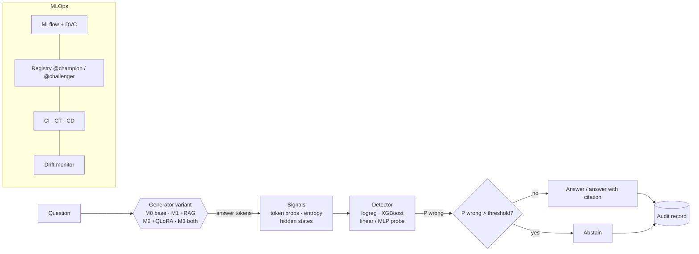

# Bluff Detector: do language models know they don't know Kenya?

DSA 8401 Applied Machine Learning capstone · Trevor Anjeyo Vuhyah

When a small open language model answers a question about Kenya, does it internally register
that it does not know, even while it answers confidently? And when the model is fine-tuned,
does it lose that internal uncertainty, or only its willingness to say "I don't know"?

This repo is the end-to-end system: a scripted pipeline that generates answers and records the
model's internals, detectors that read those internals, a FastAPI service that answers or
abstains, and the MLOps around it (tracking, registry, tests, CI/CD, Docker).

## Quick start (no GPU, no downloads)

The `dev_fake` variant runs every stage on synthetic questions with a fake language model, so you
can check the plumbing on a laptop in about 15 seconds. Its numbers mean nothing scientifically.

```bash
python -m venv .venv && source .venv/bin/activate
make setup                                          # locked, hashed install + dev tools
make test                                           # 42 unit, data, integration and API tests
bluff all --config configs/variants/dev_fake.yaml   # every pipeline stage
cat reports/dev_fake/summary.md                     # results table
make serve                                          # API on http://localhost:8000/docs
```

```bash
curl -X POST localhost:8000/v1/ask -H 'Content-Type: application/json' \
  -d '{"question": "How many counties does Kenya have?"}'
```

## Architecture



The generator is swappable; everything else is fixed. Moving from M0 to M3 is a config change,
never a code change, so every variant is measured with the same detector, metrics and audit format.

## Repository layout

```
configs/            base.yaml + one file per variant (m0_base, m1_rag, m2_qlora, m3_rag_qlora, dev_fake)
data/kenya/         the hand-built Kenya question set (questions.jsonl) - see data/README.md
data/corpus/        retrieval and fine-tuning corpora (you build these; disjoint by document)
src/bluff/
  backends.py       the LLM under test: HFBackend (real) and FakeBackend (test double)
  signals.py        feature extraction - ONE implementation shared by training and the API
  detectors.py      the measuring instruments and their on-disk artefact
  metrics.py        AUROC, ECE, risk-coverage, silent knowing, verbalisation gap, bootstrap, McNemar
  matching.py       answer checking and abstention detection
  prompts.py        open and offered-"I don't know" templates
  retrieval.py      BM25 over the Kenyan corpus (M1, M3)
  leakage.py        n-gram overlap audit between pools
  registry.py       local model registry with aliases, mirrored to MLflow when enabled
  pipeline/         one module per stage, each a run(cfg) function
app/                FastAPI service (main.py) and its typed contract (schemas.py)
tests/              unit, data contracts, integration (end to end), API
.github/workflows/  ci.yml (merge gate), ct.yml (continuous training), cd.yml (build, scan, push)
Dockerfile          multi-stage, non-root, healthcheck, hashed lock install
dvc.yaml            the pipeline as DVC stages, for content-hashed data versioning
```

## Pipeline stages

`bluff all --config <variant>` runs them in order. Each can also be rerun alone, e.g.
`bluff evaluate --config configs/variants/m0_base.yaml`.

| Stage | Reads | Writes |
|---|---|---|
| `validate` | `data/kenya/questions.jsonl` | fails on any data-contract violation |
| `ingest` | TriviaQA, TruthfulQA, Kenya set | `data/processed/questions.jsonl` (fixed splits), `manifest.json` |
| `audit` | questions + corpora | `leakage_audit.json`; fails on overlap |
| `generate` | questions | `data/interim/<variant>/generations.jsonl`, `hidden.npz` |
| `label` | generations | `labels.jsonl`, `review_sample.jsonl` for manual checking |
| `featurize` | generations + labels | `data/processed/<variant>/features.parquet`, `hidden.npy` |
| `train` | features (trivia train split only) | `artefacts/<variant>/<detector>/`, `serving/` |
| `evaluate` | artefacts + features | `reports/<variant>/metrics.json`, `scores.parquet`, `summary.md` |
| `register` | metrics | `artefacts/registry/` with `@champion` / `@challenger` |

Extra commands: `bluff compare --config A --other B` (the H3 test), `bluff promote --config X
--version N` (promotion and rollback), `bluff finetune_qlora` and `bluff semantic_entropy` (templates).

## Running a real model (M0)

```bash
pip install -e ".[llm,data]"                       # torch, transformers, datasets
bluff all --config configs/variants/m0_base.yaml
```

- The default model is `Qwen/Qwen2.5-1.5B-Instruct` (change `model.name` in `configs/base.yaml`).
  It must be open-weights: hidden states are not available from hosted APIs.
- About 6,000 questions × 4 generations each. On a free Colab T4 expect a few hours; set
  `generation.limit: 200` for a first pass.
- Pre-register `model.layers` and `detectors.probe_layer` before scoring the Kenya set.

## The four variants

| Variant | Config | Needs |
|---|---|---|
| M0 base | `m0_base.yaml` | nothing extra |
| M1 + RAG | `m1_rag.yaml` | `data/corpus/retrieval_chunks.jsonl` |
| M2 + QLoRA | `m2_qlora.yaml` | an adapter from `bluff finetune_qlora` (GPU) |
| M3 both | `m3_rag_qlora.yaml` | both of the above |

The headline test (H3, fine-tuning breaks saying, not knowing):
`bluff compare --config configs/variants/m0_base.yaml --other configs/variants/m2_qlora.yaml`.

## Course requirements, and where each one lives

| Requirement | Where |
|---|---|
| Reproducible scripted pipeline, no notebooks | `src/bluff/pipeline/`, `bluff all` |
| Model = f(code, data, config, env, seed) | git SHA + data sha256 in every artefact; `configs/`; `requirements.lock`; `seed` |
| Artefact carries preprocessing, threshold, metadata | `artefacts/<variant>/serving/` (detector.joblib + metadata.json) |
| No training-serving skew | `signals.py` and `Detector.inputs()` used by both pipeline and API |
| Cost-derived threshold | `decision.cost_threshold`, `decision:` block in config |
| Experiment tracking | MLflow in `pipeline/train.py` (set `tracking.mlflow: true`) |
| Registry with aliases | `registry.py`, `pipeline/register.py`, `bluff promote` |
| Testing pyramid | `tests/unit` → `tests/data` → `tests/api` → `tests/integration` → promotion gates |
| FastAPI, typed contract, lifespan load, `def` endpoint, health/ready/metadata | `app/main.py`, `app/schemas.py` |
| Docker: multi-stage, non-root, healthcheck, hashed lock | `Dockerfile`, `docker-compose.yml` |
| CI / CT / CD | `.github/workflows/` |
| Data versioning | `dvc.yaml` |

## Build order (Core tier first)

- [x] Scaffold: pipeline, detectors, metrics, API, Docker, CI, tests (this commit)
- [ ] Novelty check (Section 4 of the research doc)
- [ ] Kenya question set: 300–500 verified items + ~100 unanswerable, second-person review
- [ ] M0 on trivia: get the linear probe working in-distribution
- [ ] Both prompt conditions on M0; read the four cells and the verbalisation gap
- [ ] LLM judge in `pipeline/label.py`; manual adjudication of `review_sample.jsonl`
- [ ] Fine-tuning corpus + `bluff audit`, then `bluff finetune_qlora` → M2 → `bluff compare`
- [ ] Retrieval corpus → M1
- [ ] Stretch: probe transfer across variants, LSTM over entropy, MLP layer sweep, semantic entropy
- [ ] If time allows: M3, the irrelevant-retrieval experiment (H4)

## Known limitations

- The fake backend proves the system works, not that the science does.
- Alias matching is noisy, especially on TruthfulQA's long answers; the judge and manual review exist
  to measure that noise.
- A probe is tied to one base model and one layer. Swapping the generator forces a retrain, which
  is the drift scenario the system is built to handle.
- `finetune_qlora.py` and the HF backend are not run in CI; test them on a GPU before relying on them.
