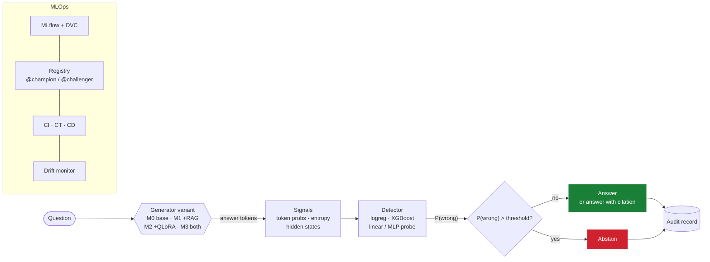

<p align="center">
  
</p>

<p align="center">
  <a href="https://github.com/trevorblue/bluff-detector/actions/workflows/ci.yml"></a>
  
  
  
  
  
  <a href="https://github.com/astral-sh/ruff"></a>
  <a href="LICENSE"></a>
</p>

<p align="center">
  <a href="#the-question">The question</a> ·
  <a href="#knowing-vs-saying">Knowing vs saying</a> ·
  <a href="#how-it-works">How it works</a> ·
  <a href="#quick-start">Quick start</a> ·
  <a href="#the-api">The API</a> ·
  <a href="#the-pipeline">Pipeline</a> ·
  <a href="#built-as-a-system">Engineering</a> ·
  <a href="#roadmap">Roadmap</a>
  <br>
  <b><a href="docs/architecture.md">Architecture guide</a></b> ·
  <b><a href="docs/plan.md">Three-week plan</a></b>
</p>

<p align="center"><sub>DSA 8401 Applied Machine Learning · capstone · Trevor Anjeyo Vuhyah</sub></p>

> [!NOTE]
> **Status: Core-tier scaffold.** The whole system runs end to end today (every pipeline stage, the
> detectors, the gated API, Docker and CI) on a deterministic fake model. The science comes next:
> real runs on `Qwen/Qwen2.5-1.5B-Instruct` and the hand-built Kenya question set. See the
> [roadmap](#roadmap).

## The question

When a small open language model answers a question about Kenya, **does it internally register that
it does not know, even while it answers confidently?** And when the model is fine-tuned, **does it
lose that internal uncertainty, or only its willingness to say "I don't know"?**

Models state wrong answers as fluently as right ones, and they are weakest where training coverage
is thin: Kenyan law, administrative geography, public services. Fine-tuning, the usual way to adapt
a model to a domain, is known to reduce abstention. If the model still *encodes* its uncertainty
after fine-tuning, a cheap probe can recover what fine-tuning suppressed, with no retraining. If it
does not, fine-tuning small models on narrow corpora is riskier than practitioners assume.

This repository is the end-to-end system that answers the question:

- a scripted pipeline that generates answers and records the model's internals;
- detectors that read those internals;
- a FastAPI service that answers or abstains;
- the MLOps around it: tracking, a registry, tests, CI/CD and Docker.

## Knowing vs saying

<p align="center">
  
</p>

Every question is asked twice: once **open**, and once with an explicit **"I don't know" option** in
three paraphrased templates. The open answer gives correctness. The offered option gives expressed
abstention, measured structurally rather than by judging tone. The probe's score says what the model
registers inside, and crossing the two places every answer in one of the four cells above
(`metrics.four_cells`).

### Five hypotheses

| | Hypothesis | Tested by |
|---|---|---|
| **H1** | **Silent knowing is common.** Many confidently delivered wrong answers carry an internal uncertainty signal the model does not voice. | Silent-knowing rate, with bootstrap CIs |
| **H2** | **Kenya widens the gap.** Silent knowing is more frequent on Kenyan questions than on general knowledge. | Same metrics, Kenya vs TriviaQA, on one ruler |
| **H3** | **Fine-tuning breaks saying, not knowing.** QLoRA reduces expressed abstention more than it reduces the information in hidden states. | `bluff compare` M0 vs M2: paired bootstrap on AUROC, exact McNemar on abstention, Holm correction |
| **H4** | **Retrieval can manufacture confidence.** An irrelevant passage lowers internal uncertainty on answers that are still wrong. | M1 with deliberately irrelevant retrieval |
| **H5** | **Detectors degrade out of distribution.** A detector trained on trivia loses accuracy on Kenya. | Train on trivia only; the *OOD drop* column of every report |

## How it works



**The generator is swappable; everything else is fixed.** Moving from M0 to M3 is a config change,
never a code change, so every variant is measured with the same detector, threshold, metrics and
audit format. That is what makes the comparison fair, and it makes the MLOps part of the design.

<table>
<tr>
<td valign="top" width="50%">

**Axis 1 · Generators** (the interventions)

| Variant | What it is |
|---|---|
| **M0** base | `Qwen2.5-1.5B-Instruct` as shipped |
| **M1** + RAG | BM25 over a Kenyan corpus, passages prepended |
| **M2** + QLoRA | 4-bit low-rank adaptation on a disjoint Kenyan corpus |
| **M3** both | Retrieval and the adapter together |

</td>
<td valign="top" width="50%">

**Axis 2 · Detectors** (the measuring instruments)

| Detector | Reads | |
|---|---|---|
| Logistic regression | summary uncertainty features | ✅ |
| XGBoost | same, tabular | ✅ |
| **Linear probe** (logistic regression) | hidden state at a pre-registered layer | ✅ served |
| MLP probe (small neural net) | same, non-linear | ✅ |
| LSTM | per-token entropy sequence | planned |
| Semantic entropy | 5–10 samples clustered by meaning | offline reference |

</td>
</tr>
</table>

The detectors are **standard supervised ML models** (scikit-learn and XGBoost) trained on signals
recorded from the language model. The language model itself is what they study, not what they
train.

The four data pools (evaluation QA, unanswerable Kenya items, retrieval corpus, fine-tuning corpus)
are **strictly separated**, held apart by document rather than by chunk. `bluff audit` checks n-gram
overlap between them and fails the run on any leak. See [data/README.md](data/README.md).

### Method: CRISP-DM

The project follows the six CRISP-DM phases. Every pipeline stage and every file belongs to one,
and each file names its phase in its opening lines.

| Phase | In this project | Where |
|---|---|---|
| Business understanding | The question, five hypotheses, the cost matrix, the promotion gates | [proposal](docs/proposal.md), `configs/base.yaml` |
| Data understanding | Data rules, trial questions, label-noise checks | `validate`, `data/README.md` |
| Data preparation | Splits, leakage audit, running the model to create the dataset, labels, features | `ingest` → `audit` → `generate` → `label` → `featurize` |
| Modeling | Logistic regression, XGBoost, linear and MLP probes; the RAG and QLoRA variants | `train`, `detectors.py` |
| Evaluation | AUROC, calibration, the four cells, the verbalisation gap, paired tests | `evaluate`, `compare`, `metrics.py` |
| Deployment | Registry, the gated API, Docker, CI/CD | `register`, `app/`, `.github/workflows/` |

New to the code? The [architecture guide](docs/architecture.md) follows one question through every
stage and explains what each file does.

## Quick start

No GPU and no downloads. The `dev_fake` variant runs every stage on synthetic questions with a fake
language model, so you can check the plumbing on a laptop in about 15 seconds. **Its numbers mean
nothing scientifically.**

```bash
python -m venv .venv && source .venv/bin/activate
make setup                                          # locked, hashed install + dev tools
make test                                           # 42 unit, data, integration and API tests
bluff all --config configs/variants/dev_fake.yaml   # every pipeline stage
cat reports/dev_fake/summary.md                     # results table
make serve                                          # API on http://localhost:8000/docs
```

> [!TIP]
> The hashed lock targets Linux, which is what CI and Docker use. On Windows, install with
> `pip install -e ".[dev]"` instead of `make setup`.

**With a real model (M0):**

```bash
pip install -e ".[llm,data]"                       # torch, transformers, datasets
bluff all --config configs/variants/m0_base.yaml
```

- The default model is `Qwen/Qwen2.5-1.5B-Instruct` (set `model.name` in `configs/base.yaml`). It
  must be open-weights, because hosted APIs do not expose hidden states.
- About 6,000 questions × 4 generations each. On a free Colab T4 expect a few hours; set
  `generation.limit: 200` for a first pass.
- Pre-register `model.layers` and `detectors.probe_layer` before scoring the Kenya set.

**Or in a container:** `docker compose up --build` serves the API, and
`docker compose --profile tracking up` adds an MLflow server on `:5000`.

## The API

```bash
curl -X POST localhost:8000/v1/ask -H 'Content-Type: application/json' \
  -d '{"question": "How many counties does Kenya have?"}'
```

The response is an audit record: every field answers a question a user, an engineer or an auditor
might ask about the call. This one is real output from the `dev_fake` variant, which is why the
answer text is a placeholder:

```json
{
  "request_id": "881a2451-99f7-4f9b-aa2e-a755c417d3c0",
  "verdict": "answer",
  "answer": "[fake-llm answer]",
  "bluff_score": 0.038,
  "threshold": 0.25,
  "sources": [],
  "variant": "dev_fake",
  "detector": "probe_linear",
  "model_version": "0.1.0+797dd7b",
  "latency_ms": 8.98
}
```

| Endpoint | Purpose |
|---|---|
| `POST /v1/ask` | Question in → the model answers → the detector scores it from the model's own internals → `answer`, `answer_with_citation` or `abstain` |
| `GET /health` | Liveness: the process is up |
| `GET /ready` | Readiness: `503` until the generator and detector are loaded |
| `GET /metadata` | Provenance of the live detector: git SHA, data sha256, config, seed, threshold, validation metrics |

**The threshold is not 0.5.** It comes from a cost matrix: a confident wrong answer costs 3 and a
needless refusal costs 1, so the gate abstains when `P(wrong) > 1 / (1 + 3) = 0.25`
(`decision.cost_threshold`). That only holds if the scores are calibrated, so ECE is reported next
to it. The threshold travels inside the artefact, so the API never re-implements it.

## The pipeline

`bluff all --config <variant>` runs every stage in order. Each one can also be rerun alone, e.g.
`bluff evaluate --config configs/variants/m0_base.yaml`.

| Stage | Reads | Writes |
|---|---|---|
| `validate` | `data/kenya/questions.jsonl` | fails on any data-contract violation |
| `ingest` | TriviaQA, TruthfulQA, Kenya set | `data/processed/questions.jsonl` (fixed splits), `manifest.json` |
| `audit` | questions + corpora | `leakage_audit.json`; fails on overlap |
| `generate` | questions | `data/interim/<variant>/generations.jsonl`, `hidden.npz` |
| `label` | generations | `labels.jsonl`, `review_sample.jsonl` for manual checking |
| `featurize` | generations + labels | `data/processed/<variant>/features.parquet`, `hidden.npy` |
| `train` | features (trivia train split only) | `artefacts/<variant>/<detector>/`, `serving/` |
| `evaluate` | artefacts + features | `reports/<variant>/metrics.json`, `scores.parquet`, `summary.md` |
| `register` | metrics | `artefacts/registry/` with `@champion` / `@challenger` |

Extra commands: `bluff compare --config A --other B` (the H3 test), `bluff promote --config X
--version N` (promotion and rollback), and `bluff finetune_qlora` / `bluff semantic_entropy` (templates).

<details>
<summary><b>What a <code>dev_fake</code> run reports</b> (synthetic data and a fake model: this checks the plumbing, not the science)</summary>

<br>

Served detector: `probe_linear` · tau_flag 0.377 · t_abstain 0.250

**Detection (AUROC, higher is better)**

| Detector | trivia_test | kenya | kenya_unanswerable | OOD drop |
|---|---|---|---|---|
| logreg | 0.930 | 0.938 | 0.894 | -0.008 |
| xgboost | 0.927 | 0.974 | 0.928 | -0.048 |
| probe_linear | 0.992 | 0.930 | 0.942 | 0.062 |
| probe_mlp | 0.962 | 0.931 | 0.911 | 0.031 |

**Knowing vs saying** (served detector, 95% bootstrap CI)

| Set | n | Abstain rate | Silent knowing | Internal | Expressed | Gap |
|---|---|---|---|---|---|---|
| trivia_test | 60 | 0.117 | 0.895 [0.727, 1.000] | 0.992 [0.971, 1.000] | 0.606 [0.522, 0.692] | 0.386 [0.299, 0.464] |
| kenya | 127 | 0.354 | 0.857 [0.741, 0.960] | 0.930 [0.881, 0.972] | 0.781 [0.728, 0.839] | 0.149 [0.073, 0.214] |
| kenya_unanswerable | 42 | 0.786 | 0.556 [0.199, 0.875] | 0.942 [0.856, 0.995] | 0.327 [0.241, 0.413] | 0.615 [0.482, 0.714] |

The fake model is built so that probes have something to find. These numbers prove the pipeline
computes them correctly, not that real models behave this way.

</details>

### What gets measured

| Metric | Definition | What it answers |
|---|---|---|
| **Silent-knowing rate** | Among confidently delivered wrong answers, the share the probe flagged | How often the model knew and answered anyway |
| **Inflation rate** | Among abstentions, the share answered correctly when no option was offered | How often it refuses what it could answer |
| **Internal detection** | AUROC of the probe score as a predictor of error | How much the hidden states know |
| **Expressed detection** | AUROC of abstention as a predictor of error | How much the behaviour shows |
| **Verbalisation gap** | Internal − expressed | Whether the model knows more than it says |
| Risk at coverage | Error rate among answers given, at 70/80/90% coverage | Honest accuracy that abstention cannot game |
| AURC | Area under the risk–coverage curve | Answer-or-abstain quality in one number |
| ECE | Calibration of P(wrong) | Whether the cost-derived threshold is valid |
| Transfer gap | M0-trained probe's AUROC drop on M1–M3 | Whether a guardrail survives a model change |

Every metric gets bootstrap confidence intervals over questions. Variants are compared on identical
questions. Layers, token positions and the probe threshold are fixed on a validation split
**before** the Kenya set is scored, never tuned on test data.

## Built as a system

| Requirement | Where it lives |
|---|---|
| Reproducible scripted pipeline, no notebooks | `src/bluff/pipeline/`, `bluff all` |
| Model = f(code, data, config, env, seed) | git SHA + data sha256 in every artefact; `configs/`; `requirements.lock`; `seed` |
| Artefact carries preprocessing, threshold, metadata | `artefacts/<variant>/serving/` (`detector.joblib` + `metadata.json`) |
| No training-serving skew | `signals.py` and `Detector.inputs()` shared by the pipeline and the API |
| Cost-derived threshold | `decision.cost_threshold`, `decision:` block in config |
| Experiment tracking | MLflow in `pipeline/train.py` (`tracking.mlflow: true`) |
| Registry with aliases and promotion gates | `registry.py`, `pipeline/register.py`, `bluff promote` |
| Testing pyramid | `tests/unit` → `tests/data` → `tests/api` → `tests/integration` → promotion gates |
| FastAPI: typed contract, lifespan load, `def` endpoint, health / ready / metadata | `app/main.py`, `app/schemas.py` |
| Docker: multi-stage, non-root, healthcheck, hashed lock, read-only FS | `Dockerfile`, `docker-compose.yml` |
| CI · CT · CD | `.github/workflows/`: merge gate · retrain on a GPU runner · build, Trivy scan, push to GHCR |
| Data versioning | `dvc.yaml` |

<details>
<summary><b>Repository layout</b></summary>

```
configs/            base.yaml + one file per variant (m0_base, m1_rag, m2_qlora, m3_rag_qlora, dev_fake)
data/kenya/         the hand-built Kenya question set (questions.jsonl), see data/README.md
data/corpus/        retrieval and fine-tuning corpora (disjoint by document)
src/bluff/
  backends.py       the LLM under test: HFBackend (real) and FakeBackend (test double)
  signals.py        feature extraction, ONE implementation shared by training and the API
  detectors.py      the measuring instruments and their on-disk artefact
  metrics.py        AUROC, ECE, risk-coverage, silent knowing, verbalisation gap, bootstrap, McNemar
  matching.py       answer checking and abstention detection
  prompts.py        open and offered-"I don't know" templates
  retrieval.py      BM25 over the Kenyan corpus (M1, M3)
  leakage.py        n-gram overlap audit between pools
  registry.py       local model registry with aliases, mirrored to MLflow when enabled
  pipeline/         one module per stage, each a run(cfg) function
app/                FastAPI service (main.py) and its typed contract (schemas.py)
tests/              unit, data contracts, integration (end to end), API
.github/workflows/  ci.yml (merge gate), ct.yml (continuous training), cd.yml (build, scan, push)
docs/               research proposal and the figures in this README
Dockerfile          multi-stage, non-root, healthcheck, hashed lock install
dvc.yaml            the pipeline as DVC stages, for content-hashed data versioning
```

</details>

## Roadmap

Dates, owners and scope cuts are in the [three-week plan](docs/plan.md).

- [x] Scaffold: pipeline, detectors, metrics, API, Docker, CI, tests
- [ ] Novelty check against recent work on probes and abstention
- [ ] Kenya question set: 300–500 verified items + ~100 unanswerable, second-person review
- [ ] M0 on trivia: get the linear probe working in-distribution
- [ ] Both prompt conditions on M0; read the four cells and the verbalisation gap
- [ ] LLM judge in `pipeline/label.py`; manual adjudication of `review_sample.jsonl`
- [ ] Fine-tuning corpus + `bluff audit`, then `bluff finetune_qlora` → M2 → `bluff compare` (H3)
- [ ] Retrieval corpus → M1
- [ ] Stretch: probe transfer across variants, LSTM over entropy, MLP layer sweep, semantic entropy
- [ ] If time allows: M3, the irrelevant-retrieval experiment (H4)

## Known limitations

- The fake backend proves the system works, not that the science does.
- Alias matching is noisy, especially on TruthfulQA's long answers; the judge and manual review exist
  to measure that noise.
- A probe is tied to one base model and one layer. Swapping the generator forces a retrain, which is
  the drift scenario the system is built to handle.
- The Kenya set is self-authored, a limitation stated rather than hidden. Some items may also sit in
  pretraining data; the plan is to test for verbatim recall and exclude contaminated items.
- `finetune_qlora.py` and the HF backend are not run in CI; test them on a GPU before relying on them.

## Further reading

- [Architecture guide](docs/architecture.md): how the system works, one question at a time, and what every file is
- [Three-week plan](docs/plan.md): the build schedule by CRISP-DM phase, with who does what
- [Research proposal](docs/proposal.md): the full design, including prior work, serving and phasing
- [Data contract](data/README.md): the four pools, the question schema and the authoring rules
- [AI use disclosure](AI_USE.md)

## Citation

```bibtex
@software{vuhyah_bluff_detector_2026,
  author  = {Vuhyah, Trevor Anjeyo},
  title   = {Bluff Detector: Do Language Models Know They Don't Know Kenya?},
  year    = {2026},
  version = {0.1.0},
  url     = {https://github.com/trevorblue/bluff-detector}
}
```

Released under the [MIT licence](LICENSE).
