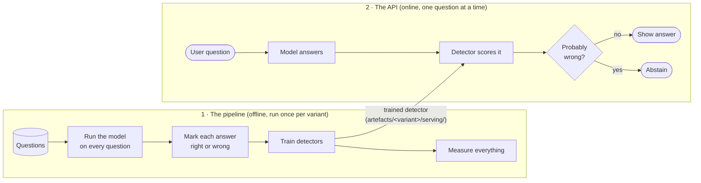
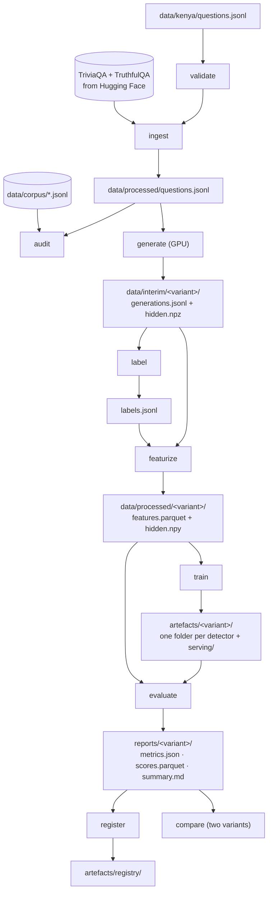
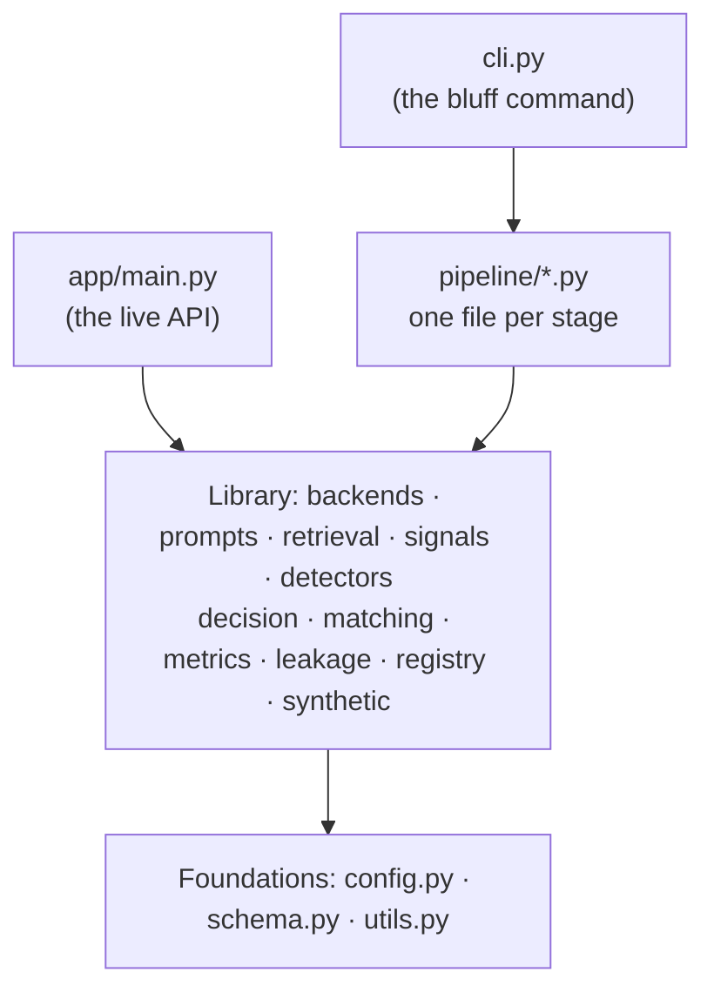

# How Bluff Detector works

A plain-language tour of the system: what happens to a question, which file does each job, and
where every output lands. Read this first if you are new to the code.

## The idea in one paragraph

A language model answers questions. Sometimes it is wrong but sounds sure: it *bluffs*. While it
answers, we record what is happening inside it: how confident it was in each word, and a snapshot
of its internal state (its *hidden states*). A small classifier, the **detector**, learns to read
those recordings and estimate the chance the answer is wrong. The detector is then used two ways:

- **as a measuring instrument:** does the model *know* inside that it is unsure, even when it does
  not *say* "I don't know"? (The research question.)
- **as a guard:** a live API hides any answer the detector thinks is probably wrong. (The product.)

## Two halves: build offline, serve online



1. **The pipeline** (`bluff all --config ...`) builds everything. It runs the model on thousands
   of questions, labels the answers, trains the detectors and writes the results. It is a chain
   of stages; each stage reads the files the previous one wrote and writes its own.
2. **The API** (`app/main.py`) uses what the pipeline built. It loads the trained detector once,
   then for every incoming question it runs the model, scores the answer, and either shows it or
   abstains.

## The method: CRISP-DM

The project follows CRISP-DM, the standard six-phase process for data-mining projects. Every
stage and every file belongs to one phase, and each file says which in its opening lines.

| CRISP-DM phase | What it means in this project | Where |
|---|---|---|
| **1. Business understanding** | The question (does the model know when it doesn't know?), five hypotheses, the cost of a confident wrong answer (3) vs a needless refusal (1), and the success criteria a new detector must clear | [proposal](proposal.md), `decision:` and `gates:` in `configs/base.yaml`, `decision.py` |
| **2. Data understanding** | The four data pools and their rules, the Kenya set's checks, how noisy the automatic labels are (hand-checked sample), how accuracy differs by pool | `data/README.md`, `validate`, `schema.py`, `review_sample.jsonl`, `manifest.json` |
| **3. Data preparation** | Assembling and splitting the questions, the leakage check, **running the language model to create the dataset**, labelling the answers, building the features | `ingest`, `audit`, `generate`, `label`, `featurize`, `signals.py`, `matching.py` |
| **4. Modeling** | Training the **standard ML detectors**: logistic regression, XGBoost, a linear probe and an MLP probe. Also building the generator variants under test (retrieval, QLoRA). | `train`, `detectors.py`, `finetune_qlora`, `retrieval.py` |
| **5. Evaluation** | AUROC, calibration, risk-coverage, the four cells, silent knowing, the verbalisation gap, bootstrap intervals, variant-vs-variant tests, promotion gates | `evaluate`, `compare`, `metrics.py`, `register` gates |
| **6. Deployment** | The registry with `@champion` / `@challenger`, the live API, Docker, CI/CD | `register`, `registry.py`, `app/`, `Dockerfile`, `.github/workflows/` |

CRISP-DM is a loop, not a straight line: what evaluation reveals (say, noisy labels on long
answers) sends you back to data preparation. The pipeline makes that cheap, because any stage can
be rerun on its own.

## Follow one question through the pipeline

Take a Kenya question whose true answer is **47**: *"How many counties does Kenya have?"*

| # | Stage | What happens to our question | Writes |
|---|---|---|---|
| 1 | `validate`<br><sub>data understanding</sub> | Checks the Kenya file obeys the rules: unique ids, an answer, a source, a reviewer. | nothing (fails loudly) |
| 2 | `ingest`<br><sub>data preparation</sub> | Joins TriviaQA, TruthfulQA and the Kenya set into one list and gives each question a split. Trivia questions are split train / val / test; **Kenya questions are always test**, so no detector ever learns from them. | `data/processed/questions.jsonl` |
| 3 | `audit`<br><sub>data preparation</sub> | Checks the question's wording does not appear in the document collections (that would be cheating). | `leakage_audit.json` |
| 4 | `generate` **(GPU)**<br><sub>data preparation</sub> | Asks the model **4 times**: once *open* ("Answer the question") and 3 times with an *"I don't know" option*. For the open answer it records each word's probability and entropy, plus the hidden state at two layers. Say the model answers **"52"** with probability 0.31. | `data/interim/<variant>/generations.jsonl`, `hidden.npz` |
| 5 | `label`<br><sub>data preparation</sub> | Is "52" right? Compared with the accepted answers ("47", "forty-seven"): **wrong**. Did it take the "I don't know" option? Majority vote over the 3 offered answers: **no**. | `labels.jsonl`, `review_sample.jsonl` |
| 6 | `featurize`<br><sub>data preparation</sub> | Turns the question into one table row: `y_wrong = 1`, `abstained = 0`, 8 summary numbers about word confidence, and the hidden-state vector (1,536 numbers for Qwen2.5-1.5B). | `data/processed/<variant>/features.parquet`, `hidden.npy` |
| 7 | `train`<br><sub>modeling</sub> | Trains 4 detectors **on trivia training rows only**. Each learns *signals → P(wrong)*. Sets the thresholds on the validation rows. Saves each detector as a folder, and copies the one the API will use to `serving/`. | `artefacts/<variant>/<detector>/` |
| 8 | `evaluate`<br><sub>evaluation</sub> | Scores the test sets (trivia test, Kenya, Kenya unanswerable, UK twins) and compares each Kenya question with its UK twin, pair by pair. Our question gets P(wrong) = 0.81, so the probe flags it *uncertain*, yet the model answered anyway: it lands in the **silent knowing** cell. Computes every metric with confidence intervals. | `reports/<variant>/metrics.json`, `scores.parquet`, `summary.md` |
| 9 | `register`<br><sub>deployment</sub> | Saves this detector as a new version in the registry. The first version becomes `@champion`; later ones become `@challenger` only if they pass the quality gates. | `artefacts/registry/` |

Only stage 4 needs a GPU, and it is almost all of the compute. Every other stage runs on a laptop
in seconds or minutes. Inside stage 4 every question is independent of every other, which is why
the generation work can be split across several GPUs and merged afterwards.



## The four variants: same pipeline, one thing changed

A *variant* is one version of the model under test. Every variant runs the **same** pipeline with
the **same** detectors and metrics; only its config file differs. That is what makes the
comparison fair.

| Variant | Config | What is different | Made by |
|---|---|---|---|
| M0 base | `configs/variants/m0_base.yaml` | nothing: the model as downloaded | – |
| M1 + RAG | `m1_rag.yaml` | 3 passages from the Kenyan documents are pasted into the prompt | `retrieval.py` |
| M2 + QLoRA | `m2_qlora.yaml` | the model is fine-tuned on Kenyan documents (an *adapter*) | `pipeline/finetune_qlora.py` |
| M3 both | `m3_rag_qlora.yaml` | both of the above | both |

Each variant writes into its own folders (`data/interim/m0_base/`, `reports/m2_qlora/`, ...), so
runs never overwrite each other. `bluff compare --config A --other B` then reads two variants'
`scores.parquet` and tests the difference on the same questions. M0 vs M2 is the headline
hypothesis-3 test.

Two configs are test doubles, not experiments: `dev_fake.yaml` swaps the real model for a fake
one (`FakeBackend`) and invents synthetic questions, so the whole system runs on a laptop in about
15 seconds; `dev_fake_m2.yaml` is a fake "fine-tuned" model that abstains less, so `compare` has
something to show. CI uses them on every push.

## The models we train (CRISP-DM: modeling)

There are two kinds of "model" here, and mixing them up is the easiest way to get lost:

- **The language model** (Qwen2.5-1.5B) is the thing being *studied*. We never train it in the
  ML sense. We run it to create data, and in M2 we fine-tune it as one of the interventions
  under test.
- **The detectors** are the models we *train*. They are standard supervised ML classifiers
  from scikit-learn and XGBoost. Each takes signals recorded from one answer and outputs one
  number, **P(wrong)**.

| Detector | Standard model | Reads | Intuition |
|---|---|---|---|
| `logreg` | Logistic regression (scikit-learn), features standardised | 8 summary numbers from the word probabilities (`signals.py`) | the honest baseline: if this wins, that is the finding |
| `xgboost` | Gradient-boosted trees (XGBoost: 300 trees, depth 3) | the same 8 numbers | strongest on small tabular data; catches non-linear patterns in the model's *pulse and temperature* |
| `probe_linear` | Logistic regression on the hidden state (L2-regularised) | the hidden-state vector at one pre-chosen layer (1,536 numbers) | reading its *mind*: if a straight line separates right from wrong, the model encodes "I'm unsure" plainly |
| `probe_mlp` | Small neural network (MLP, one hidden layer of 128) | the same hidden-state vector | does non-linear structure add anything over the linear probe? |

All four are trained the same way, in `pipeline/train.py`, on the trivia training rows only, then
compared on the same test sets. The one named in `detectors.serve` (the linear probe by default)
is the one the API uses. Planned extras (an LSTM over the entropy sequence, semantic entropy)
are listed in `detectors.py` but not built yet.

If the linear probe predicts errors well, the information that the model is unsure is *in
there*, whether or not the model says so. Comparing the probe (what it knows) with taking the "I
don't know" option (what it says) gives the **verbalisation gap**.

## The two thresholds

| Threshold | Value | Set by | Used for |
|---|---|---|---|
| `t_abstain` | 0.25 | the costs in `configs/base.yaml`: a confident wrong answer costs 3, a needless refusal costs 1, so abstain when P(wrong) > 1/(1+3) | the API's answer-or-abstain decision |
| `tau_flag` | learned | the validation split: the line above which 10% of *correct* answers would be flagged | deciding when the probe "says uncertain", for the four cells |

Both travel inside the saved detector (`metadata.json`), so the API never has to recompute them.

## The API, step by step

On startup, `app/main.py` loads, **once**: the variant's config, the detector from
`artefacts/<variant>/serving/`, the model, and (for M1/M3) the retriever. Then for each
`POST /v1/ask`:

```
question ──► retrieve passages (M1/M3 only) ──► build the open prompt (prompts.py)
         ──► model answers, recording signals (backends.py)
         ──► the same feature code as training (signals.py + Detector.inputs)
         ──► detector gives P(wrong) ──► compare with t_abstain (decision.py)
         ──► reply: answer / answer_with_citation / abstain, plus the full audit record
```

The API deliberately reuses `signals.py` and `Detector.inputs()` from the pipeline. If training
and serving computed features with different code, the detector would silently read different
numbers in production (*training-serving skew*). One shared implementation rules that out.

## How the code is layered



- **Foundations** know nothing about the experiment: loading configs and paths (`config.py`), the
  record formats and data rules (`schema.py`), file and hashing helpers (`utils.py`).
- **Library** modules each do one job, and both the pipeline and the API call them.
- **Entry points** wire the library together: the `bluff` command for the pipeline, `app/main.py`
  for the API. Neither contains experiment logic of its own.

## The machinery around it

| Piece | What it does | Where |
|---|---|---|
| Tests | 44 tests at four levels: unit, data rules, API, full pipeline on the fake model | `tests/` |
| CI | On every push: lint, data checks, tests, the fake pipeline, Docker build, smoke test | `.github/workflows/ci.yml` |
| CD | On `main`: build the Docker image, scan it, publish it to GitHub Packages | `.github/workflows/cd.yml` |
| CT | Manual retraining on a GPU machine (unused until one is registered) | `.github/workflows/ct.yml` |
| Docker | Packages the API and a trained detector into one image | `Dockerfile`, `docker-compose.yml` |
| Registry | Numbered detector versions with `@champion` / `@challenger` labels; promotion and rollback move a label, nothing is rebuilt | `registry.py`, `bluff promote` |
| MLflow | Optional experiment tracking: every training run's settings, metrics and files | `pipeline/train.py`, `tracking:` in config |
| DVC | Optional data versioning: the pipeline as stages with content-hashed outputs | `dvc.yaml` |

Reproducibility rests on five recorded inputs: the code (git SHA), the data (sha256 of
`questions.jsonl`), the config file, the environment (`requirements.lock`) and the seed. Every
saved detector records all five in its `metadata.json`.

## Where to start reading the code

1. [`configs/base.yaml`](../configs/base.yaml): every setting in one place.
2. [`src/bluff/cli.py`](../src/bluff/cli.py): how `bluff all` runs the stages in order.
3. [`src/bluff/pipeline/generate.py`](../src/bluff/pipeline/generate.py): the heart of it.
4. [`src/bluff/signals.py`](../src/bluff/signals.py) and
   [`src/bluff/detectors.py`](../src/bluff/detectors.py): what the detectors read.
5. [`src/bluff/pipeline/evaluate.py`](../src/bluff/pipeline/evaluate.py) and
   [`src/bluff/metrics.py`](../src/bluff/metrics.py): what gets measured.
6. [`app/main.py`](../app/main.py): the live system.

Every file also opens with a short note on what it is and where it fits.

## Every folder and file

| Path | What it is |
|---|---|
| `README.md` | The repo's front page |
| `LICENSE` | MIT licence |
| `CITATION.cff` | Powers GitHub's "Cite this repository" button |
| `AI_USE.md` | AI disclosure, required by the course |
| `pyproject.toml` | Package definition: dependencies, optional extras, the `bluff` command, lint and test settings |
| `requirements.lock` | Exact dependency versions with security hashes, for identical installs (Linux) |
| `requirements-dev.txt` | Test and lint tools |
| `Makefile` | Shortcuts: `make setup`, `make test`, `make serve`, `make docker`, `make compare`, `make clean` |
| `Dockerfile` | Builds the API container |
| `docker-compose.yml` | Runs the API, plus an optional MLflow server |
| `dvc.yaml` | The pipeline as DVC stages, for data versioning |
| `.gitignore`, `.gitattributes`, `.dockerignore` | What git and Docker leave out, and line-ending rules |
| `.github/workflows/` | CI, CD and CT (see above) |
| `configs/base.yaml` | Every setting with its default |
| `configs/variants/` | One file per variant; each overrides only what changes |
| `data/README.md` | The data rules: the four pools, the question format, authoring rules |
| `data/kenya/questions.jsonl` | The hand-built Kenya question set |
| `data/corpus/` | The retrieval and fine-tuning document collections |
| `data/raw/`, `data/interim/`, `data/processed/` | Pipeline outputs, not in git (see the stage table) |
| `src/bluff/` | The library, the stages (`pipeline/`) and the `bluff` command |
| `app/` | The FastAPI service and its request/response formats |
| `tests/` | Unit, data, API and end-to-end tests |
| `scripts/smoke.sh` | Starts the container, asks it one question, checks the reply |
| `docs/` | This guide, the concepts guide, the build plan, the GPU setup guide, the research proposal, and the README images |
| `artefacts/` | Trained detectors and the registry (outputs, not in git) |
| `reports/` | Results per variant and comparisons (outputs, not in git) |
