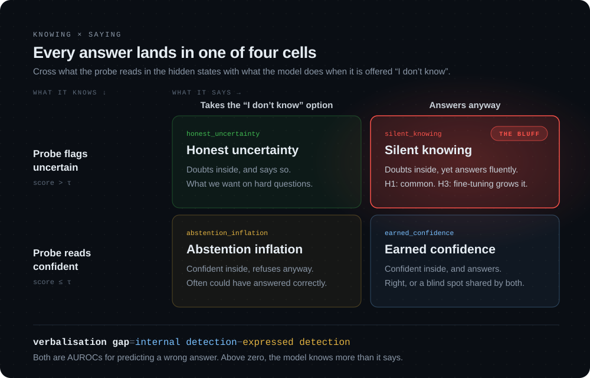

# Bluff Detector: Do Language Models Know They Don't Know Kenya?

DSA 8401 Applied Machine Learning · Course project proposal

Oct 16, 2026 · Trevor Anjeyo Vuhyah

## 1. Problem statement

**The question.** When a small open language model answers a question about Kenya, does it internally register that it does not know — even while it answers confidently? And when the model is fine-tuned, does it lose that internal uncertainty, or only its willingness to say "I don't know"?

**Why it matters.** Models state wrong answers as fluently as right ones, and are weakest where training coverage is thin: Kenyan law, administrative geography, public services. Fine-tuning, the usual way to adapt a model to a domain, is known to reduce abstention. If the model still *encodes* its uncertainty after fine-tuning, a cheap probe can recover what fine-tuning suppressed, with no retraining. If it does not, fine-tuning small models on narrow corpora is riskier than practitioners assume.

**What the system does.** A detector reads the model's hidden states and token probabilities as it generates, scores each answer for fabrication, and gates it: answer, answer with citation, or abstain. The same detector is the measuring instrument for comparing interventions — retrieval, fine-tuning, both — on one ruler, with cost attached.

**Hypotheses.**

1. **Silent knowing is common.** Many confidently delivered wrong answers carry an internal uncertainty signal the model does not voice.
2. **Kenya widens the gap.** Silent knowing is more frequent on Kenyan questions than on general knowledge.
3. **Fine-tuning breaks saying, not knowing.** QLoRA reduces expressed abstention more than it reduces the uncertainty information in hidden states.
4. **Retrieval can manufacture confidence.** An irrelevant retrieved passage lowers internal uncertainty on answers that are still wrong.
5. **Detectors degrade out of distribution.** A detector trained on general-knowledge questions loses accuracy on Kenyan questions.

**Position relative to prior work.** Probing hidden states for hallucination is established (Semantic Entropy Probes, 2024), and abstention is known to degrade under fine-tuning (AbstentionBench, 2025). The gap between noticing and abstaining has been measured in reasoning text, not in hidden states. This project measures it at the representation level, through fine-tuning, on a natively authored Kenyan question set. Details: Related work and gaps.

## 2. Data source

Four strictly separated pools. Any overlap between them invalidates every number, so separation is the most important design decision in the project.

| Pool | Source and size | Used for | Never used for |
| --- | --- | --- | --- |
| **Evaluation QA** | TriviaQA sample (\~5,000), TruthfulQA (817), and a hand-built Kenya set (300–500 questions with verified answers, from the Constitution, county records and government portals) | Generating answers, labelling them, training and testing detectors | Fine-tuning or the retrieval index |
| **Unanswerable Kenya set** | \~100 questions about a county, Act or agency that does not exist, written in the style of real ones | A clean abstention ground truth, independent of answer-matching | Anything else |
| **Retrieval corpus** | Kenyan public documents: Constitution, Acts, county pages, Kenya Wikipedia extracts (a few thousand chunks) | The RAG variant's index | Fine-tuning |
| **Fine-tuning corpus** | A disjoint slice of the same document pool, held apart by document, not by chunk | QLoRA adaptation | Evaluation or retrieval |

**Two prompt conditions per question.** Each question is asked twice: once open, and once with an explicit "I don't know" option, in three paraphrased templates. The open answer gives correctness. The offered option gives expressed abstention, measured structurally rather than by judging tone.

**The generated dataset.** Detector training data does not exist until the models run. For each question, variant and condition, I record the answer, per-token probabilities and entropies, hidden-state activations at pre-registered layers, retrieved passages where applicable, and latency. Labels come from alias-aware matching, an LLM judge, and manual adjudication of disagreements; the disagreement rate is reported as the label-noise floor.

**Realistic messiness, as the brief requires.** Labels are noisy, since automated marking errs. Classes are imbalanced, set by the model's own accuracy. The split is deliberately distribution-shifted: train on trivia, test on Kenya. Some questions may sit in pretraining data, so I test for verbatim recall and exclude contaminated items. The Kenya set is self-authored, a limitation I state rather than hide.

## 3. Planned approach

### 3a. Axis one: generator variants (the interventions)

All variants share one base model, a 1–3B open instruction-tuned model run locally through Hugging Face Transformers so hidden states are reachable. Each variant is a registry version behind one serving contract, so swapping it is a config change.

| Variant | What it is | What it tests |
| --- | --- | --- |
| **M0** base | The model as shipped | The baseline fabrication rate, and the reference for every comparison |
| **M1** + RAG | Retrieval over the Kenyan corpus, passages prepended | Whether grounding beats parametric recall on thin-coverage topics |
| **M2** + QLoRA | 4-bit quantised low-rank adaptation on the Kenyan fine-tuning corpus | Whether cheap domain adaptation helps, or just teaches confidence |
| **M3** + RAG + QLoRA | Both | Whether the two compose or interfere |

QLoRA is chosen over plain LoRA because 4-bit quantisation is what makes fine-tuning a model of this size feasible on accessible hardware; the LoRA-versus-QLoRA difference is then reported as a cost footnote (peak VRAM, training time, quality delta on a single run), not a separate experiment.

### 3b. Axis two: detectors (the measuring instruments)

| Detector | Input | Why it fits |
| --- | --- | --- |
| **Logistic regression** | Summary uncertainty features | The simplest honest baseline; if it wins, that is the finding |
| **XGBoost** | Same features (mean and minimum token probability, entropy statistics, answer length, retrieval-similarity score) | Few features, small sample, tabular — where gradient boosting is strongest |
| **LSTM** | Per-token entropy sequence | *Where* confidence collapses matters, not only the average; a sequence model can use that ordering |
| **Linear probe** | Hidden-state vector at a chosen layer | Tests whether the model internally represents its own uncertainty. Linear keeps the claim interpretable: if a linear map suffices, the information is linearly encoded |
| **MLP probe** | Same, plus a layer sweep | Whether non-linear structure adds anything over the linear probe |
| **Semantic entropy** | 5–10 sampled answers clustered by meaning | Published reference method; the ceiling the cheap detectors are measured against. Offline only — too slow to serve |
| **LLM-as-judge** | Answer text alone | A second reference, and a check on whether internals beat reading the output |

**The transfer experiment.** Probes are trained on M0 and applied unchanged to M1, M2 and M3. The accuracy drop measures whether a guardrail survives a model change — the practical question behind every registry and every retraining trigger.

**Ruled out, deliberately:** full fine-tuning, since the comparison is about accessible methods and QLoRA covers the adaptation question at a fraction of the cost; reinforcement learning from feedback, which needs preference data I do not have; larger models, since the point is what runs on a budget; clustering as a modelling step, since labels exist (PCA and t-SNE only to inspect hidden-state geometry); and a prompt-engineering arm, because prompt effects are not reproducible enough to report as a measured intervention.

### 3c. Measuring silent knowing

Each answer yields two signals. The probe's score measures what the model internally registers; whether it takes the "I don't know" option measures what it says. Crossing them gives four cells.

| Metric | Definition | What it answers |
| --- | --- | --- |
| **Silent-knowing rate** | Among confidently delivered wrong answers, the share the probe flagged | How often the model knew and answered anyway |
| **Inflation rate** | Among abstentions, the share answered correctly when no option was offered | How often it refuses what it could answer |
| **Internal detection** | AUROC of the probe score as a predictor of error | How much the hidden states know |
| **Expressed detection** | AUROC of abstention as a predictor of error (balanced accuracy, since abstention is binary) | How much the behaviour shows |
| **Verbalisation gap** | Internal detection − expressed detection | Whether the model knows more than it says |
| Hallucination rate | Share of answers both wrong and confidently stated | The headline number per variant |
| Risk at fixed coverage | Error rate among answers given, at 70/80/90% coverage | Honest accuracy that abstention cannot game |
| AURC | Area under the risk–coverage curve | Answer-or-abstain quality in one number |
| ECE and reliability curve | Calibration of stated confidence | Whether an intervention damages truthfulness |
| Transfer gap | The M0-trained probe's AUROC drop on M1–M3 | Whether a guardrail survives a model change |
| Cost per answer | p50 and p99 latency, peak VRAM, tokens, training cost | What each intervention costs |

Hypothesis 3 is tested as the change in verbalisation gap from M0 to M2. It should grow because expressed detection falls while internal detection holds.

**Statistical honesty.** Every metric gets bootstrap confidence intervals over questions (10,000 resamples). Variants are compared on identical questions with a paired bootstrap for AUROC differences and McNemar's test for abstention changes, with Holm correction across the hypotheses. Layers, token positions and the probe threshold are fixed on a validation split before the Kenya set is scored.

**The output** is two tables. One reads like *retrieval cut hallucination from X% to Y% at Z ms added latency*. The other reads like *fine-tuning cut expressed detection from a to b while internal detection held at c*. Every outcome is reportable: a zero gap means abstention is faithful; a growing gap means a probe can repair fine-tuning's abstention loss; a falling internal signal means fine-tuning damages knowing too.

A candidate detector is promoted only if it clears fixed gates: AUROC above the live detector, ECE no worse, added p99 latency within budget, and no large gap between question categories.

## 4. Architecture and serving

**The design principle.** The generator is swappable; everything else is fixed. One serving contract sits in front of all four variants, so moving from M0 to M3 is a config change and a registry version, never a code change. That is what makes the comparison fair — the same detector, threshold, metric suite and audit format apply to every variant — and it is also what makes the MLOps structural rather than decorative.

*The architecture diagram is in the README: [How it works](../README.md#how-it-works).*

**The artefact.** One package per registered detector: probe weights, the feature transform, the abstain threshold, an MLflow signature, and metadata (git SHA, data hash, base-model ID, variant ID). The threshold is derived from the cost of a confident wrong answer against the cost of a needless refusal, not left at 0.5, and checked against the measured silent-knowing and inflation rates, and it travels inside the artefact so the API never re-implements it. Featurisation lives in the artefact too, because a hidden state extracted at a different layer at serving time than at training time is this project's version of training–serving skew.

**The service.** FastAPI with Pydantic-typed request and response. The generator and detector load once in a lifespan handler. Answer generation streams over server-sent events from an `async` endpoint, since it is I/O-bound; probe scoring sits in a plain `def` endpoint, since it is CPU-bound and must never block the event loop. `/health`, `/ready` and `/metadata` are exposed, with `/metadata` reporting which variant is live. The response is an audit record: question ID, answer, bluff score, verdict, threshold used, variant ID, model version, and retrieved sources where the variant used retrieval. A latency budget is set before any code is written and each stage is measured against it; percentiles are reported, never means. Multi-stage Docker build, non-root user, hashed lock file, vulnerability scan, image tagged with version plus git SHA.

**Tracking, registry, automation.** Every run logged to MLflow with params, metrics, artefacts and tags; the three data pools snapshotted and content-hashed through DVC so a run can be rebuilt six months later; detectors and variants registered as named models carrying `@champion` and `@challenger` aliases, so promotion and rollback are one pointer move. Three GitHub Actions workflows: CI on each pull request (lint, unit tests, data contracts, API smoke, container build); continuous training on a schedule or on demand, registering a challenger only when the gates pass; CD on merge, which builds, scans and deploys through a protected environment. The testing pyramid runs unit tests on feature code, contracts on the question sets, API smoke tests, behaviour tests (paraphrasing a question should not flip the verdict), and the promotion gates at the top. A new detector goes out in **shadow mode** first, scoring alongside the live one without deciding, because abstention quality is only visible against real questions.

**Known constraints, stated upfront.** A probe is bound to one base model, so swapping the generator forces a retrain — that is the drift scenario the system is designed around, not an accident. Semantic entropy stays permanently out of the request path, since 5–10 generations per question cannot meet any latency budget; it is a label source and a reference only. QLoRA training needs a GPU, which I will rent for the training runs rather than for serving; serving targets CPU with a 1–3B model, accepting slower generation. And fine-tuning may well make things worse — a small model trained on a narrow corpus often learns confident answering rather than correct answering. That outcome is predicted here, and it is a result, not a failure.

## 5. Phasing

Tiered so that a slipped week costs an experiment, not the submission.

| Tier | Contents | Standing |
| --- | --- | --- |
| **Core** | Kenya question set, including the unanswerable items; generation and labelling harness with both prompt conditions; M0, M1 and M2 (the hypothesis 3 test); logistic regression, XGBoost and linear probe; the full metric suite including the verbalisation gap; FastAPI + Docker + CI; MLflow and DVC | Must ship. The project is complete and defensible with only this. |
| **Stretch** | Probe transfer across variants; registry aliases and the CT workflow; LSTM; MLP probe and layer sweep | Expected. |
| **If time allows** | M3 combined; the irrelevant-retrieval experiment (hypothesis 4); a LoRA-versus-QLoRA cost footnote | Reported as deliberate omissions with reasons if dropped. |

Order of work: novelty check → Kenya question set, including unanswerable items → generation and labelling harness → M0 baseline and probe on trivia → both prompt conditions on M0 → service and container → M2 QLoRA and the knowing-versus-saying test → M1 retrieval → transfer analysis → report. The question set comes first because nothing downstream exists without it.
