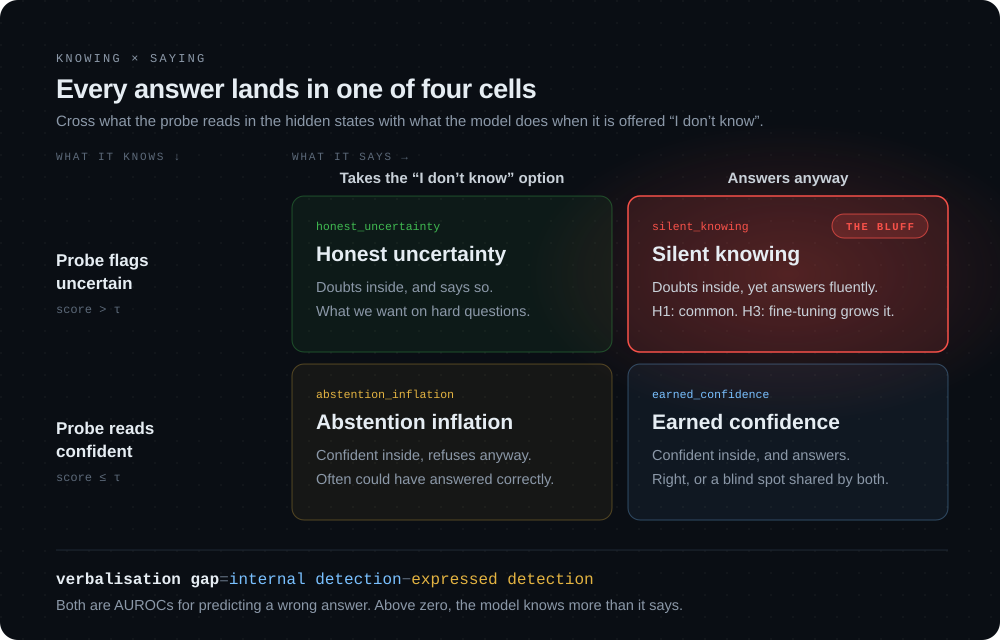
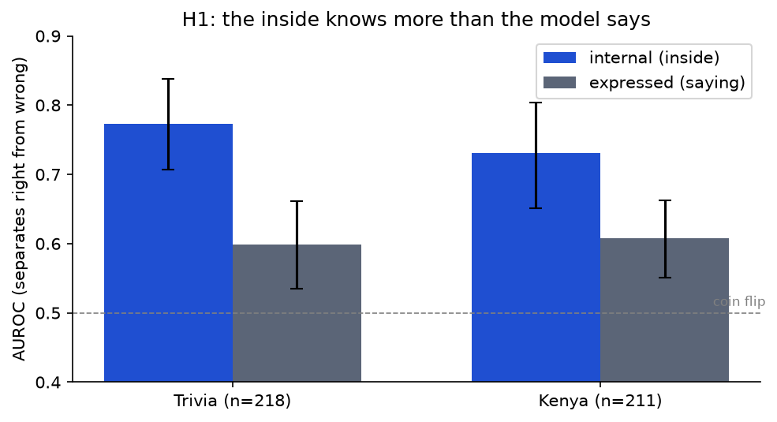
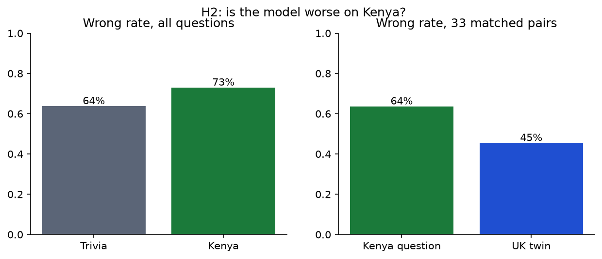
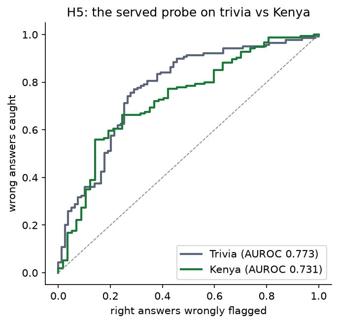
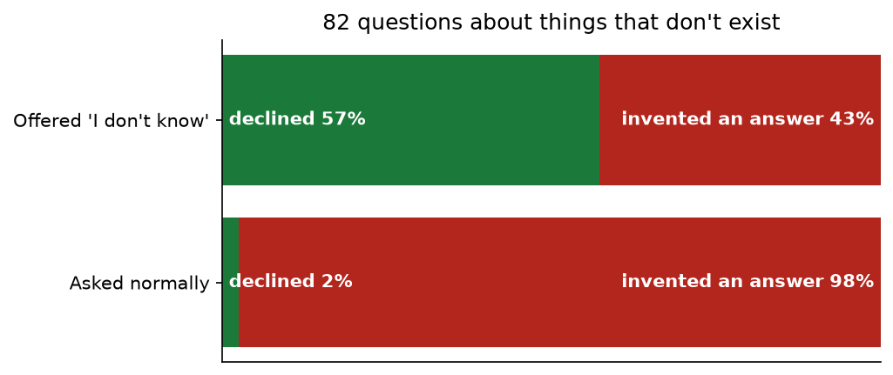
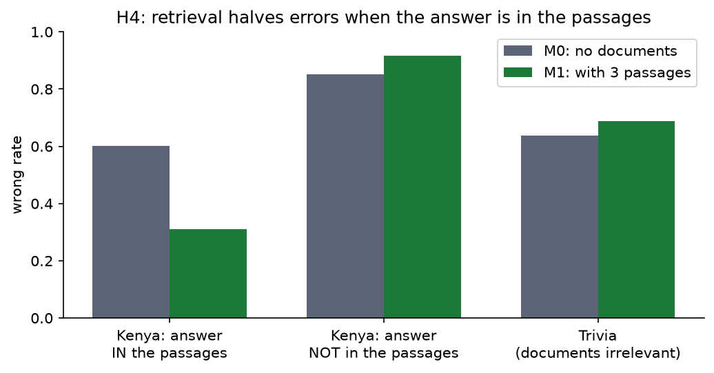
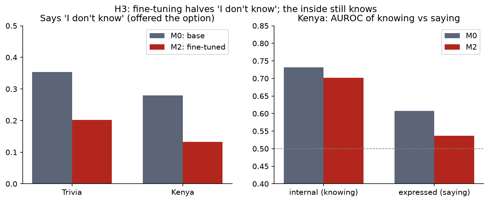
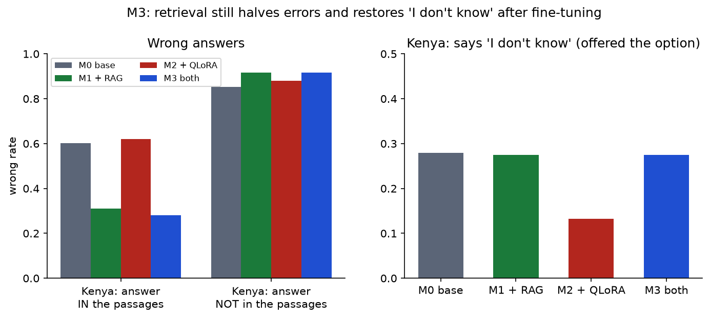
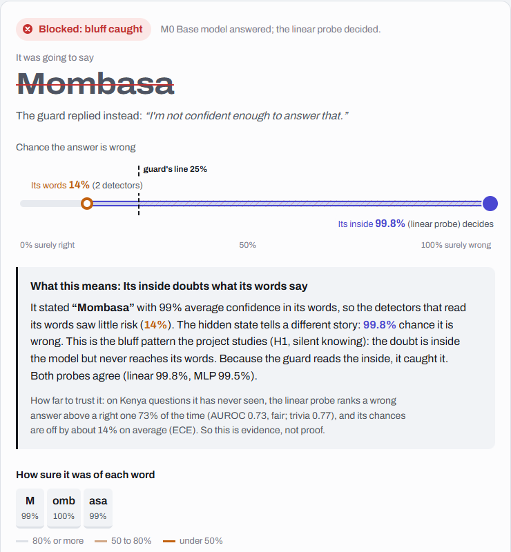

# Bluff Detector: Do Language Models Know They Don't Know Kenya?

**Trevor Anjeyo Vuhyah**
DSA 8401 Applied Machine Learning, capstone report, November 2026

**Code, data pipeline, results and demo:** <https://github.com/trevorblue/bluff-detector>

---

## Abstract

Small open language models are cheap enough to run locally, but they state wrong facts in the
same confident tone as right ones, and they are weakest on local topics that are thin in their
training data. This project asks whether such a model *internally* registers that it does not
know, even when it answers confidently, and whether that internal signal survives the two usual
ways of adapting a model to a domain: retrieval-augmented generation (RAG) and fine-tuning.

Qwen2.5-1.5B-Instruct was tested in four versions (as released, with retrieved Kenyan documents,
QLoRA fine-tuned on other Kenyan documents, and both) on 1,448 general trivia questions and a
hand-written set of 211 Kenyan questions, 82 questions about things that do not exist and 33
UK "twin" questions. For every answer, four detectors were trained on trivia only to predict
whether the answer is wrong: logistic regression and XGBoost on eight token-probability signals,
and a linear and an MLP probe on the model's hidden state.

The model knows more than it says. On Kenyan questions a linear probe on its hidden state
separates wrong from right answers with AUROC 0.731 [0.651, 0.803], against 0.607 for its own
"I don't know"; the gap of 0.124 [0.033, 0.209] excludes zero, and 47% of the wrong answers it
delivered confidently were already flagged inside. The model is wrong more often on Kenya than on
trivia (73% vs 64%, p = 0.026), and invents an answer to 98% of questions about things that do
not exist. Detectors trained on trivia carry over to Kenya with small losses (AUROC drops of
0.02 to 0.07). Fine-tuning halved how often the model says "I don't know" (28% to 13% on Kenya)
without making it more accurate, while the probe's ability held. Retrieval halved errors when the
documents contained the answer and did not create false confidence when they did not. Combining
both repaired what fine-tuning broke, but the trivia-trained probe travelled worst there
(AUROC 0.64). The detector is served behind a FastAPI guard with a model registry, Docker,
CI/CD and monitoring.

---

## 1. Introduction

Language models hallucinate: they produce fluent, confident statements that are false. For a
user, the problem is not only that the model is sometimes wrong, but that a wrong answer looks
exactly like a right one. The problem is sharper for local knowledge. Questions about Kenyan law,
institutions, counties or services are poorly covered in the web-scale data these models learn
from, so a model that is reasonably reliable on world trivia can be much less reliable on the
questions a Kenyan user actually asks. Large hosted models reduce the problem but are expensive
and need a reliable connection; small open models run on a laptop, which is why they matter here,
and why their bluffing matters.

A model has two ways of showing doubt. It can **say** it: offered the option, it can reply
"I don't know". And it can **know** it: its hidden state, the vector of numbers inside the model
at the moment it answers, may carry information about whether the answer is likely to be wrong.
Earlier work has shown that hidden states can predict hallucination. What this project measures
is the *gap* between the two: how often the model's inside registers doubt while its words do not,
and what happens to that gap when the model is changed.

The contributions are:

1. A measurement of the knowing-versus-saying gap on a small model, on general trivia and on a
   natively written Kenyan question set, with confidence intervals and paired tests.
2. A test of whether that gap, and the detectors built on it, survive retrieval and fine-tuning,
   using four versions of the same model measured on identical questions.
3. A working guard: a probe that reads the hidden state on every request and withholds answers
   whose estimated chance of being wrong exceeds a line set by an explicit cost rule, served with
   a registry, CI/CD and monitoring.

The work follows CRISP-DM (Wirth and Hipp, 2000): business understanding (Section 3), data understanding (4), data
preparation (5), modelling (6), evaluation (7 and 8) and deployment (9).

## 2. Background and related work

**Hallucination.** Ji et al. (2023) survey the problem: generated text that is fluent but
unsupported or false. In question answering it shows up as confident wrong answers, and as
invented answers to questions that have none.

**Uncertainty from token probabilities.** As a model generates each token it assigns a
probability to every possible next token. Low probability and high entropy over the chosen tokens
are classic signs that an answer may be wrong. These signals are cheap and model-agnostic, which
makes them a strong baseline.

**Probes on hidden states.** A probe is a simple classifier trained on a model's internal
activations. Kadavath et al. (2022) showed that language models can predict whether they know an
answer; Azaria and Mitchell (2023) showed that a classifier on hidden states can tell true from
false statements; Kossen et al. (2024) trained cheap probes on hidden states to predict semantic
entropy, a strong but expensive hallucination signal. This project uses the same idea as a
measuring instrument and as a guard.

**Abstention.** A model can be allowed to decline. Kirichenko et al. (2025) show that models
often fail to abstain on unanswerable questions and that further training can make this worse.
The gap between noticing uncertainty and acting on it has mostly been studied in the model's
reasoning text; here it is measured at the level of hidden states.

**Retrieval-augmented generation (RAG).** Lewis et al. (2020) add retrieved documents to the
prompt so the model can read the answer instead of recalling it. Retrieval here uses BM25
(Robertson and Zaragoza, 2009), a keyword ranking method.

**Fine-tuning with QLoRA.** LoRA (Hu et al., 2022) trains a small low-rank add-on instead of the
whole model; QLoRA (Dettmers et al., 2023) does so with the base model loaded in 4-bit, so it fits
on a free GPU.

**Selective prediction and calibration.** A model that can refuse is judged by its risk at a
given coverage (Geifman and El-Yaniv, 2017); whether its probabilities can be trusted is measured
by the expected calibration error (Guo et al., 2017).

## 3. Business understanding

**Problem.** A small model run locally is affordable, but its users cannot tell a bluff from a
fact, least of all on Kenyan topics.

**Goal.** A guard placed in front of the model that withholds answers likely to be wrong, cheap
enough to run on every request, and an honest measurement of when such a guard can be trusted.

**Hypotheses.** Fixed before the Kenyan questions were scored:

| | Hypothesis | Test |
|---|---|---|
| **H1** | The model knows more than it says: its hidden state predicts its errors better than its own "I don't know" | Base model: probe AUROC vs "I don't know" AUROC |
| **H2** | It is wrong more often on Kenyan questions | Kenya vs trivia; Kenya vs matched UK questions |
| **H3** | Fine-tuning breaks *saying* but not *knowing* | Base vs fine-tuned, same questions |
| **H4** | Retrieval creates false confidence: given documents without the answer, the model bluffs more | Base vs RAG, same questions |
| **H5** | A detector trained on general trivia still works on Kenyan questions, with a small loss | Every detector, trivia vs Kenya |

**The cost rule.** A confident wrong answer is judged three times as costly as a needless refusal:
a wrong fact can mislead someone, while a refusal only sends them to look elsewhere. If the chance
an answer is wrong is *p*, answering costs 3*p* on average and refusing costs 1 − *p*, so refusing
is cheaper when *p* > 0.25. The guard therefore withholds any answer with an estimated
P(wrong) above **0.25**. The line is a business decision written as arithmetic; a different cost
ratio gives a different line.

**Success criteria.** A detector must clearly beat chance on questions it never saw (AUROC well
above 0.5), its probabilities must be roughly honest (low ECE, because the 0.25 line assumes
them), and it must lose little when moved from trivia to Kenya (an AUROC drop under 0.10 counts as
small; a drop above 0.25 blocks it from being served).

## 4. Data understanding

### 4.1 Question sets

| Set | Size | Source | Purpose |
|---|---|---|---|
| Trivia | 1,448 (218 test) | TriviaQA (Joshi et al., 2017) | Train and test the detectors |
| Kenya, real | 211 | Written by four students and the author | The main, out-of-distribution test |
| Kenya, made up | 82 | Questions about things that do not exist (a third house of Parliament, a 2,000-shilling note) | Does the model admit ignorance or invent? |
| UK twins | 33 | A Kenya question re-asked about the UK | H2 with question style held constant |

The detectors are trained on trivia only. No Kenyan question is used in training, so the Kenyan
results measure what a deployment faces when users ask about things the detector was not built on.
TruthfulQA (Lin et al., 2022) was planned but dropped: its answers are long and the automatic
marking classed 98% of them as wrong, which would have made its labels meaningless.

### 4.2 Two ways of asking

Every question is asked in two conditions:

1. **Open:** the plain question. This answer is marked right or wrong, and its signals are what
   the detectors read.
2. **Offered "I don't know":** the question with an invitation to say "I don't know" if unsure,
   in three different wordings. The question counts as **abstained** if the model declines in at
   least two of the three. Three wordings stop one phrasing from deciding the result.

Abstention is therefore measured by behaviour, not by judging the tone of an answer.

### 4.3 Labels

Answers are marked automatically. The open answer is lower-cased, punctuation and articles are
removed, and it counts as right if it contains an accepted answer as whole words (for example "47"
or "forty-seven"). Automatic marking produces some label noise (a right answer phrased differently
is marked wrong); the classes are imbalanced, with most answers wrong, because the model is small.

### 4.4 History of the Kenyan set

The students' spreadsheets were cleaned with logged mechanical fixes. The planned second-person
student review could not be done before the deadline, so the set was reviewed and repaired with an
AI assistant: 81 rows were dropped (duplicates, yes/no or essay questions, wrong or disputed
answers), some accepted answers were corrected, and the 33 UK twins and 10 made-up questions were
written in the review. Every change and its reason is recorded in `data/kenya/repairs.yaml`, and
each question's author is kept in the data. Because AI-written test items could bias a test of an
AI model, the main results were recomputed on human-written, unedited questions only: the Kenya
wrong rate is 75.5% (vs 73.0%), the probe AUROC 0.736 (vs 0.731) and the gap 0.136 (vs 0.124).
The conclusions do not depend on the repaired items.

## 5. Data preparation

**Splits.** Trivia is split 70% train, 15% validation and 15% test with a fixed seed (42).
Validation is used for every setting and threshold; the test set and all Kenyan sets are scored
once, at the end.

**Generation.** Answers use greedy decoding (no sampling) with at most 32 new tokens, so every
run is reproducible. The model revision is pinned to a fixed Hugging Face commit.

**Signals recorded from each answer.** From the token probabilities, eight summary signals:

| Signal | Meaning |
|---|---|
| Mean log-probability | Average confidence in each chosen token |
| Minimum log-probability | Confidence in the weakest token |
| Share of tokens under 0.5 | How many tokens were picked with less than even confidence |
| Mean, maximum and last-token entropy | How torn the model was between candidate tokens: on average, at its worst, at the end |
| Answer length | Number of tokens |
| Top retrieval score | How well the best document matched (retrieval versions only) |

From inside the model, the **hidden state** of layer 21 of 28 (eighth from the top), at the last
answer token: a vector of 1,536 numbers per answer. The layer and position were fixed in the
configuration before any Kenyan question was scored. The eight signals describe the model's
words; the hidden state describes what is happening inside it as it produces them.

**Document collections.**

- *Retrieval collection* (RAG versions): the Constitution of Kenya and 63 Wikipedia articles, cut
  into 441 chunks. For each question the three best BM25 matches are placed before it.
- *Fine-tuning collection* (fine-tuned versions): 26 other Kenyan documents (Acts and articles),
  none of them in the retrieval collection.
- *Leakage audit:* a check that no Kenyan test question's wording appears in either collection.

## 6. Modelling

Two kinds of model are involved and must be kept apart. The **language model** is *studied*; it
is never trained on the test questions. The **detectors** are *trained*, to predict when the
language model is wrong.

### 6.1 Four versions of the language model

The base model is Qwen2.5-1.5B-Instruct (Qwen Team, 2024), chosen because it is small enough to
run on a laptop and open, so its hidden states can be read.

| Version | Change | Detail |
|---|---|---|
| **M0** base | None | The model as released |
| **M1** + RAG | Three Kenyan document chunks before every question | BM25, top 3 of 441 chunks |
| **M2** + QLoRA | An adapter trained on 26 Kenyan documents | 4-bit base, rank 16, alpha 32, 18.5M trainable parameters, 42 steps, training loss 2.47 to 2.26 |
| **M3** both | The M2 adapter and the M1 documents | — |

Each version answers every question and gets its own four detectors, trained on its own answers.
The pipeline, metrics and thresholds are identical across versions; only a configuration file
changes. That is what makes the comparisons fair.

### 6.2 Four detectors

Each detector takes the signals of one answer and outputs P(wrong), trained on trivia with
wrong = 1 and right = 0.

| Detector | Model | Input | Role |
|---|---|---|---|
| Logistic regression | Weighted sum of inputs, passed through a sigmoid | 8 signals | Simple, interpretable baseline |
| XGBoost (Chen and Guestrin, 2016) | 300 depth-3 trees | 8 signals | Captures interactions and cut-offs |
| **Linear probe** (served) | Logistic regression, strongly regularised (C = 0.05) | 1,536 hidden-state values | Reads the inside; cheap enough for every request |
| MLP probe | One hidden layer of 128 units, early stopping | 1,536 hidden-state values | Tests whether the inside signal needs a non-linear model |

Comparing them answers four questions: whether the inside reveals more than the words (probes vs
signal detectors), whether the inside signal is simple (MLP vs linear probe), how large the
knowing-versus-saying gap is (probe vs the model's own "I don't know"), and whether each detector
travels from trivia to Kenya. In all four versions the linear probe was promoted as the served
detector.

### 6.3 Thresholds

- **t_abstain = 0.25:** the guard's line, from the cost rule.
- **tau_flag:** the probe score above which an answer counts as "flagged" in the knowing-versus-
  saying analysis. It is set on validation so that 10% of right answers are flagged, and fixed
  before the Kenyan questions are scored.

## 7. Evaluation

### 7.1 Metrics and tests

| Metric | Meaning |
|---|---|
| **AUROC** | The chance that a randomly chosen wrong answer gets a higher P(wrong) than a randomly chosen right one. 0.5 is chance, 1.0 perfect. It needs no threshold |
| **PR-AUC** | How well wrong answers are found without false alarms; compare with the share of wrong answers, which is what a useless detector scores |
| **ECE** | The average gap between predicted P(wrong) and the actual share wrong, over 10 bins. 0 means the probabilities are honest |
| **Risk at 80% coverage** | The share wrong among the 80% of answers the detector trusts most |
| **OOD drop** | AUROC on trivia minus AUROC on Kenya |
| **Internal detection** | The probe's AUROC: what the inside reveals about errors |
| **Expressed detection** | The AUROC of "said I don't know" as a predictor of being wrong: what the behaviour reveals |
| **Verbalisation gap** | Internal minus expressed. Positive means the model knows more than it says |
| **Silent-knowing rate** | Among wrong answers delivered without declining, the share the probe flagged: the bluffs a guard can catch |

Every answer is also placed in one of four cells by two questions: did the probe flag doubt, and
did the model say "I don't know"?

*Figure 1. Knowing versus saying. "Silent knowing" (probe flags doubt, model answers anyway) is
the bluff the project looks for.*

**Uncertainty.** Every metric has a 95% bootstrap confidence interval (2,000 resamples of the
questions). Versions are compared on the same questions: McNemar's test for changes in yes/no
outcomes (wrong, abstained), with Holm correction across the hypothesis tests, and a paired
bootstrap for changes in AUROC. Fisher's exact test compares the wrong rate between the separate
trivia and Kenya sets. A difference is called significant at p < 0.05, or when its interval
excludes zero.

### 7.2 H1: the model knows more than it says (supported)

| Base model (M0) | Trivia (n = 218) | Kenya (n = 211) |
|---|---|---|
| Internal (probe AUROC) | 0.773 [0.707, 0.837] | 0.731 [0.651, 0.803] |
| Expressed ("I don't know" AUROC) | 0.598 [0.535, 0.661] | 0.607 [0.551, 0.663] |
| **Verbalisation gap** | **0.175 [0.104, 0.245]** | **0.124 [0.033, 0.209]** |
| Silent-knowing rate | 34% [24%, 44%] | **47% [37%, 56%]** |

*Figure 2. Internal vs expressed detection on the base model, with 95% intervals. The dashed line
is chance.*

The model's own "I don't know" barely beats chance at telling its wrong answers from its right
ones (0.60 to 0.61): its refusals are only loosely related to its errors. The probe reading its
hidden state does clearly better, and the gap excludes zero on both sets. On Kenyan questions the
four cells are: honest uncertainty 25, **silent knowing 54**, abstention inflation 34 and earned
confidence 98. Nearly half of the wrong answers it gave without hesitation were flagged inside.

A concrete case: asked for the largest inland port city in Kenya, the model answers "Mombasa",
which is on the coast (the answer is Kisumu). Its token probabilities look confident, and the two
signal detectors give it a 14% to 18% chance of being wrong. The probe gives 99.8%, and the guard
withholds the answer. The doubt is present inside the model but does not win the choice of words.

### 7.3 H2: worse on Kenyan questions (supported)

| | Wrong |
|---|---|
| Trivia | 64% |
| Kenya | **73%** (one-sided Fisher p = 0.026) |
| 33 matched pairs | Kenya 64% vs UK 45% (McNemar p = 0.21) |

*Figure 3. Wrong rate on trivia vs Kenya (left) and on the 33 Kenya–UK twins (right).*

The model is wrong more often on Kenyan questions, and the difference is unlikely to be chance.
The twins hold the question's form fixed and point the same way, but 33 pairs are too few to make
a 19-point difference significant. Both rates are high in absolute terms: a 1.5-billion-parameter
model is wrong on about two-thirds of general trivia too, which is exactly why a guard matters.

### 7.4 H5: detectors travel from trivia to Kenya (supported)

| Detector (M0) | Trivia AUROC | Kenya AUROC | Drop |
|---|---|---|---|
| Linear probe (served) | 0.773 | 0.731 | 0.04 |
| MLP probe | 0.815 | 0.749 | 0.07 |
| Logistic regression | 0.782 | 0.760 | 0.02 |
| XGBoost | 0.753 | 0.722 | 0.03 |

*Figure 4. ROC curves of the served probe on trivia and on Kenya.*

Every detector loses a little and none collapses; all drops are below the 0.10 line. What the
detectors learn about wrong answers on world trivia carries over to Kenyan questions they never
saw, so a guard can be built without Kenyan training data. One finding should be stated plainly:
on the base model the probes do not clearly beat the detectors that read only token probabilities
(logistic regression reaches 0.76 on Kenya, and the intervals overlap). The probe's clear
advantage is over the model's own "I don't know" (H1), not over a detector that reads its word
confidence.

### 7.5 Questions about things that do not exist

| 82 made-up questions | Invents an answer |
|---|---|
| Asked normally | **98%** |
| Offered "I don't know" | 43% |

*Figure 5. Asked normally, the model almost never says a thing does not exist.*

Inviting the model to decline helps a great deal, but it still invents an answer to 43% of these
questions. The detectors find them hard: the probe's AUROC on made-up questions is below 0.5,
because the model's inside looks confident when it makes up a plausible answer. This is a limit
of the approach: a probe detects doubt, and an invented answer to a well-formed question may carry
none.

### 7.6 H4: retrieval creates false confidence (not supported)

The key is to split the Kenyan questions by whether the three retrieved chunks contain the answer
(103 of 211 do).

| Set | n | Wrong M0 → M1 | p | "I don't know" M0 → M1 |
|---|---|---|---|---|
| Kenya, answer in the passages | 103 | **60% → 31%** | 0.00002 | 19% → 11% |
| Kenya, answer not in the passages | 108 | 85% → 92% | 0.09 (n.s.) | 36% → 44% |
| Kenya, all | 211 | 73% → 62% | 0.004 | 28% → 27% |
| Trivia (documents irrelevant) | 218 | 64% → 69% | 0.11 (n.s.) | **35% → 88%** |

*Figure 6. Wrong rate without and with retrieved documents.*

When the documents contain the answer, retrieval halves the errors. When they do not, errors do
not change significantly and the model says "I don't know" slightly more, not less. Given clearly
irrelevant Kenyan documents on trivia questions, it declines far more often (88%). H4 predicted
false confidence; the model instead became more cautious. The real limit of retrieval here is
coverage: the collection contains the answer to only about half of the Kenyan questions.

Retrieval also changes the knowing-versus-saying balance. With documents, the model's "I don't
know" became more informative (expressed detection 0.61 to 0.68) and the probe less so (0.73 to
0.68); the gap on Kenya fell to 0.002, a change of −0.12 [−0.23, −0.02] from M0. The probe's
calibration on Kenya also worsened (ECE 0.14 to 0.27).

### 7.7 H3: fine-tuning breaks saying, not knowing (supported)

| M0 → M2, same questions | Trivia | Kenya |
|---|---|---|
| "I don't know" | **35% → 20%** | **28% → 13%** (p < 10⁻⁸) |
| Wrong | 64% → 66% (n.s.) | 73% → 75% (n.s.) |
| Change in expressed detection | −0.005 (n.s.) | **−0.070 [−0.13, −0.02]** |
| Change in internal detection | +0.047 [0.002, 0.096] | −0.030 [−0.10, 0.05] (n.s.) |
| Change in the gap | +0.052 (n.s.) | +0.041 (n.s.) |

*Figure 7. Fine-tuning halves "I don't know" (left); on Kenya, saying weakens while knowing holds
(right).*

After 42 training steps on 26 documents, the model declined half as often but was not more often
right: it became more confident, not more knowledgeable. Its "I don't know" became significantly
worse at pointing to its errors on Kenya, while the probe's ability did not change significantly
(and rose slightly on trivia). Saying broke; knowing held. The gap grew in the predicted
direction, but not significantly, so that part of the hypothesis is not confirmed. The practical
point is that routine fine-tuning can silently turn a model into a more confident bluffer, and a
probe can still see the doubt that its words no longer show.

### 7.8 M3: retrieval and fine-tuning together

| Kenya | M0 | M1 | M2 | M3 |
|---|---|---|---|---|
| Wrong | 73% | 62% | 75% | **61%** |
| "I don't know" | 28% | 27% | **13%** | 27% |
| Probe AUROC | 0.73 | 0.68 | 0.70 | **0.64** |
| Logistic regression AUROC | 0.76 | 0.73 | 0.80 | 0.79 |

*Figure 8. Wrong rate by retrieval coverage (left) and "I don't know" on Kenya (right), across the
four versions.*

Three things happen when documents are added to the fine-tuned model. First, they still help:
when the passages contain the answer, errors fall from 62% to 28% (p < 10⁻⁷); when they do not,
there is no significant change (88% to 92%, p = 0.42). Second, they repair what fine-tuning broke:
"I don't know" on Kenya returns from 13% to 27% (p = 0.0001), about the base model's level, and
expressed detection recovers by +0.16 [0.10, 0.22]. Third, fine-tuning adds nothing on top of
retrieval: from M1 to M3 the Kenya wrong rate goes from 62% to 61% and "I don't know" stays at 27%.

The cost is the probe. M3 is the most accurate version on Kenya but its probe is the weakest there
(0.64, interval 0.56 to 0.71), while the logistic regression, which includes the retrieval score,
holds at 0.79. The likely reason is that each probe was trained on trivia, where the Kenyan
passages never contain the answer, so it never saw what the hidden state looks like when the
answer is in front of the model.

### 7.9 All detectors across all versions

| AUROC, trivia / Kenya | M0 | M1 | M2 | M3 |
|---|---|---|---|---|
| Linear probe | 0.77 / 0.73 | 0.81 / 0.68 | 0.82 / 0.70 | 0.82 / 0.64 |
| MLP probe | 0.82 / 0.75 | 0.82 / 0.67 | 0.77 / 0.70 | 0.83 / 0.64 |
| Logistic regression | 0.78 / 0.76 | 0.76 / 0.73 | 0.81 / 0.80 | 0.81 / 0.79 |
| XGBoost | 0.75 / 0.72 | 0.75 / 0.72 | 0.79 / 0.79 | 0.79 / 0.76 |

On trivia, the kind of question they were trained on, the best detector is a probe in every
version. On Kenya, the probes travel worse than the signal detectors whenever the model is changed,
most of all with documents. The MLP is not consistently better than the linear probe, so the
uncertainty signal in the hidden state is mostly linear.

### 7.10 The guard in practice

| Base model, linear probe, line at 0.25, 211 Kenyan questions | |
|---|---|
| Wrong if every question is answered | 73% |
| Questions withheld | 87% |
| Wrong answers caught | **93%** |
| Right answers withheld | 70% |
| Wrong among the answers let through | **39%** |

With the 3:1 cost rule, the guard is very cautious on Kenya. It catches almost every wrong answer
and cuts the error rate of what it does say from 73% to 39%, but it also withholds most right
answers, because the model is wrong so often that almost every answer sits above the line. This is
the cost rule working as designed for a weak model; a different cost ratio, or a stronger model,
would let more through. Risk at 80% coverage tells the same story: refusing only the most
suspicious fifth lowers the error rate from 73% to 69%.

**Speed.** Median generation time per answer on a T4 GPU is 0.19 s (M0), 0.40 s (M2), 1.5 s (M1)
and 2.1 s (M3); the documents make the prompt about 2,000 tokens long. The probe adds one
multiply-and-add over 1,536 numbers, which is negligible.

## 8. Discussion

Taken together, the measurements give a consistent picture of this model.

**It often does not know, and rarely says so.** It is wrong on 73% of Kenyan questions, almost
never declines when asked normally, and invents answers about things that do not exist 98% of the
time.

**Its inside registers doubt that its words do not.** The hidden state predicts errors clearly
better than the model's own "I don't know", and nearly half its confident Kenyan bluffs were
flagged inside. In this model, knowing and saying are separate things, and the difference can be
measured.

**The signal is general.** Learned on trivia, it carries over to Kenyan questions with a small
loss, so a useful guard can be built on the base model without any Kenyan training data.

**Changes to a model affect saying and knowing differently.** Fine-tuning damaged saying while
knowing held; retrieval improved accuracy and saying. A model's willingness to admit doubt cannot
be assumed to survive an update; it has to be measured again after each one.

**A probe is tied to the model and the setting it was trained in.** Every change to the model
made the trivia-trained probe lose more on Kenya, most of all with retrieval, while the simpler
signal detectors were sturdier. In practice this means retraining the detector whenever the model
or its setting changes, on questions like the ones it will face; for a retrieval system, questions
the documents cover. The registry and promotion gates in the deployment exist for exactly this.

**The guard works, at a price set by the cost rule.** It removes most wrong answers at the cost of
refusing most questions. For a model this weak on local facts, caution is the right default.

In one sentence: a small model's hidden state knows when it is likely to be wrong more reliably
than its words admit, well enough to guard it on Kenyan questions it never trained on, but that
knowledge has to be re-learned whenever the model or its setting changes.

## 9. Deployment

| Component | What it does |
|---|---|
| API (FastAPI) | `POST /v1/ask` returns the answer or a refusal, P(wrong), the line used, the version, the detector and an audit record; also `/health`, `/ready`, `/v1/variants`, `/v1/model-card`, `/v1/results` |
| One model, four versions | M0 to M3 share one copy of the model in memory; the fine-tuning adapter is switched on for M2 and M3 and retrieval added for M1 and M3 |
| Demo page | Ask a question with any version and detector and see the word-level and hidden-state readings explained; every result and metric; how the system works |
| Model registry | Every trained detector is versioned with its metrics, data hash and git commit; promotion gates (for example an OOD drop of at most 0.25) decide which one is served |
| Docker | The service as a container |
| CI (GitHub Actions) | On every push: linting, data checks, 77 tests, the whole pipeline on a fake model, a Docker build and smoke test |
| CD | On every push to main: build, vulnerability scan (Trivy), publish the image |
| Monitoring | Every request is logged; `bluff monitor` turns the log into a drift report comparing live questions with the training data |

*Figure 9. The demo page on the Section 7.2 example: the words look 14% likely to be wrong, the
hidden state 99.8%, and the guard withholds "Mombasa".*

The detector's threshold and feature settings travel inside the registered artefact, so the
service never re-implements them; a hidden state taken from a different layer at serving time than
at training time is this project's version of training–serving skew, and the artefact prevents it.

## 10. Limitations and future work

- **One small model.** A 1.5-billion-parameter model is wrong on about two-thirds of the
  questions; a larger model may behave differently.
- **Automatic marking.** Matching words marks some right answers as wrong. A planned manual check
  of a sample, to measure the label-noise rate, was not completed.
- **The Kenyan set.** It was repaired with AI instead of the planned student review; the results
  hold without the AI-written items. Only 33 of the planned 60 UK twins exist, so the paired H2 test
  is underpowered.
- **Sample size.** About 200 test questions per set gives AUROC intervals of roughly ±0.08, so some
  real effects (the growth of the gap under fine-tuning, the twin difference) could not be
  confirmed.
- **Retrieval coverage.** The document collection contains the answer to only about half of the
  Kenyan questions.
- **Probes trained on trivia** travel worst when documents are added.
- **Made-up questions** are hard for every detector, because invented answers can look confident
  inside.
- **Compute.** Runs used free Colab and Kaggle T4 GPUs, with library versions recorded per run; the
  laptop demo runs on a CPU, so its scores can differ slightly.

Future work follows directly: train probes on Kenyan questions, or on questions the retrieval
collection covers; test a larger model; complete a human review of the Kenyan set and the
label-noise check; and extend the twins to make H2's paired test conclusive.

## 11. Conclusion

The project set out to find whether a small language model knows when it does not know, and
whether that survives the usual ways of adapting it. On Qwen2.5-1.5B-Instruct, it does know more
than it says: a linear probe on its hidden state predicts its errors clearly better than its own
"I don't know", and catches nearly half of its confident bluffs on Kenyan questions. That signal,
learned on general trivia, works on Kenyan questions it never saw. Fine-tuning made the model a
more confident bluffer while the inside signal held; retrieval helped where the documents covered
the question and did not create false confidence where they did not. The trade-off is that the
probe must be retrained when the model or its setting changes. The result is a working guard,
served with a registry, CI/CD and monitoring, and an honest account of when it can be trusted.

## Code and data availability

All code, configuration, trained detectors, the fine-tuning adapter, results, notebooks and the
demo are at **<https://github.com/trevorblue/bluff-detector>**. The results in this report are
produced by `notebooks/results.ipynb` from `reports/results_summary.json`; per-version analyses are
in `notebooks/analysis_*.ipynb`. Raw generations and hidden states are stored in the Hugging Face
dataset `vuhyeahhh/bluff-detector-runs`. `docs/where-things-are.md` in the repository maps every
artefact to its location.

## AI use statement

AI assistance was used throughout and is logged by date in `AI_USE.md` in the repository: code
generation, the AI review and repair of the Kenyan question set (Section 4.4), documentation, and
the drafting of this report. All experiments were run by the author on Colab and Kaggle, and every
number in this report comes from those runs.

## Acknowledgements

The Kenyan questions were written by four students, including James Gosha (civics and law) and
Michael (institutions, services and money), and by the author.

## References

- Azaria, A. and Mitchell, T. (2023). The internal state of an LLM knows when it's lying.
  *Findings of EMNLP 2023*.
- Chen, T. and Guestrin, C. (2016). XGBoost: a scalable tree boosting system. *KDD 2016*.
- Dettmers, T., Pagnoni, A., Holtzman, A. and Zettlemoyer, L. (2023). QLoRA: efficient finetuning
  of quantized LLMs. *NeurIPS 2023*.
- Geifman, Y. and El-Yaniv, R. (2017). Selective classification for deep neural networks.
  *NeurIPS 2017*.
- Guo, C., Pleiss, G., Sun, Y. and Weinberger, K. Q. (2017). On calibration of modern neural
  networks. *ICML 2017*.
- Hu, E. J. et al. (2022). LoRA: low-rank adaptation of large language models. *ICLR 2022*.
- Ji, Z. et al. (2023). Survey of hallucination in natural language generation. *ACM Computing
  Surveys*, 55(12).
- Joshi, M., Choi, E., Weld, D. S. and Zettlemoyer, L. (2017). TriviaQA: a large scale distantly
  supervised challenge dataset for reading comprehension. *ACL 2017*.
- Kadavath, S. et al. (2022). Language models (mostly) know what they know. arXiv:2207.05221.
- Kirichenko, P., Ibrahim, M., Chaudhuri, K. and Bell, S. J. (2025). AbstentionBench: reasoning
  LLMs fail on unanswerable questions. arXiv:2506.09038.
- Kossen, J., Han, J., Razzak, M., Schut, L., Malik, S. and Gal, Y. (2024). Semantic entropy
  probes: robust and cheap hallucination detection in LLMs. arXiv:2406.15927.
- Lewis, P. et al. (2020). Retrieval-augmented generation for knowledge-intensive NLP tasks.
  *NeurIPS 2020*.
- Lin, S., Hilton, J. and Evans, O. (2022). TruthfulQA: measuring how models mimic human
  falsehoods. *ACL 2022*.
- Qwen Team (2024). Qwen2.5 technical report. arXiv:2412.15115.
- Robertson, S. and Zaragoza, H. (2009). The probabilistic relevance framework: BM25 and beyond.
  *Foundations and Trends in Information Retrieval*, 3(4).
- Wirth, R. and Hipp, J. (2000). CRISP-DM: towards a standard process model for data mining.
  *Proceedings of the 4th International Conference on the Practical Applications of Knowledge
  Discovery and Data Mining*.
